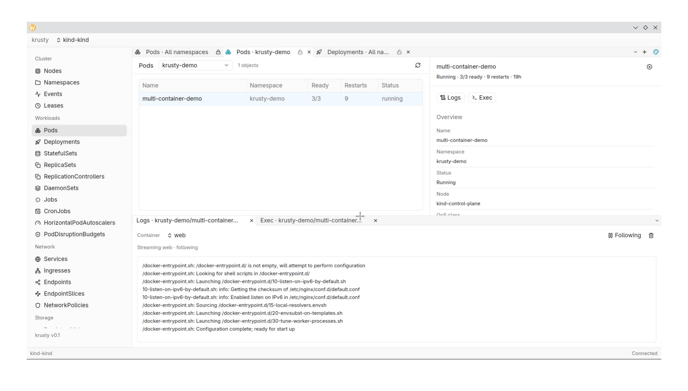

# krusty

A native Kubernetes desktop client written in Rust with [GPUI Kit](https://gpui-kit.com).



## What it does

krusty is a fast, native desktop UI for everyday Kubernetes work:

- Live list and watch views for Pods, Deployments, DaemonSets, Jobs, Services,
  Ingresses, ConfigMaps, Secrets, PersistentVolumes, PersistentVolumeClaims, and
  Nodes.
- Dedicated detail panes for every resource, including conditions, capacity,
  images, addresses, taints, labels, annotations, and the raw manifest.
- Live CPU and memory charts in node and pod details when
  [metrics-server](https://github.com/kubernetes-sigs/metrics-server) is
  available.
- Cluster context switching from the title bar with per-tab namespace filtering.
- Multiple kubeconfigs managed inside the app, including pasted credentials.
- Light, dark, and system themes.
- Responsive layouts that keep the list and detail panes side by side on wide
  windows and switch to a focused detail view on narrow ones.

## Getting started

You need a Rust toolchain that supports edition 2024 and a kubeconfig. The app
reads `$KUBECONFIG` or `~/.kube/config` on startup and can also store kubeconfigs
added inside the app.

```sh
cargo run --release
```

For iterative development with automatic rebuilds and restarts:

```sh
./scripts/dev.sh
```

On Linux, install the font and windowing development packages before building.
For Debian/Ubuntu:

```sh
sudo apt-get install build-essential pkg-config \
  libfontconfig1-dev libfreetype6-dev libwayland-dev \
  libx11-xcb-dev libxkbcommon-dev libxkbcommon-x11-dev \
  libxcb1-dev libxcb-render0-dev libxcb-shape0-dev \
  libxcb-xfixes0-dev libxcb-randr0-dev libxcb-composite0-dev \
  libxcb-damage0-dev libxcb-present-dev libxcb-xkb-dev
```

## Packaging

Release builds are produced by `.github/workflows/build.yml`:

- Linux x86_64 and arm64 binaries, packaged as `.tar.gz` archives.
- Flatpak bundles for x86_64 and arm64 from
  `packaging/flatpak/io.github.GT020.Krusty.yml`.
- A macOS arm64 DMG.

Pushing a `v*` tag builds all targets and attaches them to a GitHub release.

Local packaging helpers:

```sh
./scripts/package-linux.sh
./scripts/package-macos.sh
```

## License

krusty is licensed under the GNU General Public License v2.0 only. See
[LICENSE](LICENSE).
